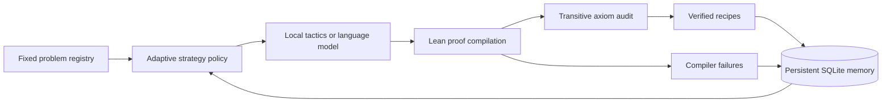

# RC Research

RC Research searches for Lean proofs against a fixed problem registry. It
stores compiler feedback and verified proof recipes in SQLite, retrieves
relevant experience, and learns which strategies work in each mathematical
domain. Later runs use that accumulated experience.

This is an initial verifier-guided research system. Its online learning
updates strategy statistics and retained examples. Generative model weights
stay with the selected provider. The included arithmetic and operator tasks
are calibration and reconstruction exercises. The research queue includes
a project obligation for stability near an idempotent contraction. A claim
to have solved a recognised open problem requires the original problem
statement, a checked matching theorem, and independent novelty assessment.



## Run locally

From the repository root, using the existing environment and pinned Lean
installation, run

```powershell
.venv-audit/Scripts/python.exe -m rc_research doctor
.venv-audit/Scripts/python.exe -m rc_research list
.venv-audit/Scripts/python.exe -m rc_research run --max-attempts 12 --max-seconds 600
.venv-audit/Scripts/python.exe -m rc_research status
```

The default backend is an adaptive local tactic policy. It searches with
Lean tactics and previously verified recipes. It runs without model-service
credentials. A fresh Lean process imports the compiled project for each
attempt, which can take tens of seconds on this laptop. The default per-proof
timeout is 60 seconds. Initial setup of the pinned dependency cache follows
the existing instructions in `lean/README.md`.

For a local language model served by Ollama, install and start Ollama,
download a model suitable for the machine, and select its installed name.
The doctor command lists models offered by the default local server.

```powershell
.venv-audit/Scripts/python.exe -m rc_research run --provider ollama --model YOUR_INSTALLED_MODEL --max-model-calls 4 --max-attempts 4 --max-seconds 600
```

For an OpenAI model, configure `OPENAI_API_KEY` locally and choose an available
model that supports Structured Outputs. Each invocation has an explicit
request-count and output-token cap. Model requests transmit the chosen goal,
its listed repository context and selected prior attempts to the provider.

```powershell
.venv-audit/Scripts/python.exe -m rc_research run --provider openai --model YOUR_MODEL --max-model-calls 4 --max-output-tokens 4096 --max-attempts 4 --max-seconds 600
```

The OpenAI request uses the Responses API, strict JSON Schema and `store=false`.
The provider response supplies a proof body and a rationale. Lean decides
acceptance. Model refusals, malformed JSON, incomplete output, transport
errors and proof failures remain recorded as failed attempts.
[Official Structured Outputs documentation](https://developers.openai.com/api/docs/guides/structured-outputs?api-mode=responses)

The Ollama provider uses a nonstreaming `/api/generate` request with the same
JSON schema. Its model name is supplied explicitly.
[Ollama API documentation](https://docs.ollama.com/api/generate)

The inspected machine has approximately 64 GB RAM and an NVIDIA Quadro T2000
with 4 GB VRAM. Local model performance depends on the chosen quantization
and CPU offloading. This package uses Python's standard library and the
existing Lean toolchain.

## How adaptation works

1. Load a trusted goal and fingerprint its statement, split and provenance.
2. Select a tactic with an upper-confidence-bound policy, or request a proof
   from a configured model using prior compiler failures and verified examples.
3. Check the proposal language and insert the proof into a fixed theorem wrapper.
4. Compile the actual theorem and inspect its transitive axioms in Lean.
5. Record the result transactionally. Verified training recipes become available
   for future problems, and domain-specific strategy statistics update.
6. Continue within the attempt, model-call and elapsed-time budgets. Later runs
   resume from persistent memory and skip already verified goals in the same
   source environment.

The model receives no filesystem or shell tools through this provider interface.
The evaluator and problem registry are outside the proposal language. A source
or registry change during a run stops acceptance under the previous environment.
Retained proofs are scoped by hashes of the Lean project, toolchain manifests
and research-runner source. Changing those files starts a fresh learning scope.

## Evaluation and exported data

Holdout tasks are checked separately. Their proofs, failures and results are
excluded from strategy learning and model feedback retrieval. Training examples
remain available to the held-out run. Each evaluation runs afresh with the
learned policy frozen and exploration disabled. The small supplied holdout set is a smoke
test and provides a limited assessment of generalization.

```powershell
.venv-audit/Scripts/python.exe -m rc_research run --split holdout --max-attempts 8 --max-seconds 600
.venv-audit/Scripts/python.exe -m rc_research run --split research --problem record_stability_transfer --max-attempts 6 --max-seconds 600
.venv-audit/Scripts/python.exe -m rc_research export --out research/local_validation/rc_research/verified-training-v1.jsonl
```

Export includes verified training records in the current environment and checks
each retained source hash before writing a new JSONL file. These records can
support later dataset curation and fine-tuning. Human review of statement
meaning, source attribution and train/test independence is still required.

## Acceptance and operational boundaries

Acceptance requires successful compilation and a proof-dependent audit marker.
The allowed transitive axioms are `propext`, `Classical.choice` and `Quot.sound`.
The source generator fixes the theorem statement. Added declarations,
placeholder proofs, common metaprogramming commands and native-decision
shortcuts are rejected in model proof text. Numerical agreement alone cannot
produce a verified Lean result.

The proof-language filter is a restriction on syntax. The compiler runs as a
local subprocess and has no additional OS security sandbox. Use OS isolation
before accepting proposals from an adversarial source. This first version
assumes a trusted local runtime and the existing project dependencies.

One OS-held lock serializes writes to each state directory. Status queries use
a separate read-only SQLite connection while a research run is active.
SQLite transactions
protect complete trial records. A crashed process releases its lock. Interrupted
runs are preserved and subsequent invocations can continue with new budgets.
After acquiring the writer lock, a new run marks stale running entries as interrupted.
The process runner kills the owned subprocess tree on timeout. Each Lean
process has a 4096 MB memory limit. HTTP requests
run in a separate worker with a total deadline. Output-token caps and request
counts bound configured model usage, while monetary charges follow the provider.

Runs return status `completed`, `budget_exhausted` or `search_exhausted`, with
remaining goal IDs. Exit code 2 means the selected goals remain unfinished.
Each attempt retains its proposal, generated Lean source and compiler log under
the ignored state directory. The source tree and Git repository are updated
through the normal human-controlled development workflow.

## Tests

```powershell
.venv-audit/Scripts/python.exe -m unittest discover -s tests -v
$env:RC_RESEARCH_LEAN_TESTS = '1'
.venv-audit/Scripts/python.exe -m unittest discover -s tests -p test_rc_research_lean.py -v
```

The regression suite exercises fixed-goal feedback, learning persistence,
environment scoping, held-out isolation, failed-proof exclusion, malformed
proposals, provider payloads and HTTP deadlines. Mocked model responses test
the loop's mechanics. Actual Lean-run evidence is retained separately from
those unit tests. The supplied examples measure execution and acceptance
behaviour. Hard open-problem solving remains an empirical research objective.

The [retained local validation](../research/rc_research_validation_2026-11-10/manifest.json)
records 14 passing unit tests and three passing real Lean integration checks.
A training arithmetic goal required three strategies, and a related held-out
goal passed on the learned policy's first attempt. An established operator
inequality was reconstructed and replayed through the current verifier.
The export check produced a verified training record. Live generative inference
awaits a configured model connection. These calibration results give a limited
assessment of capability on difficult mathematics.
